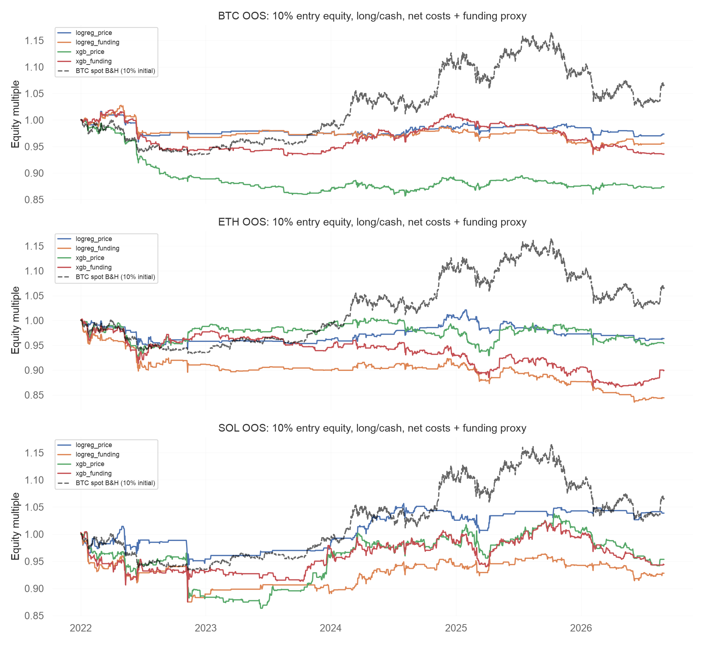
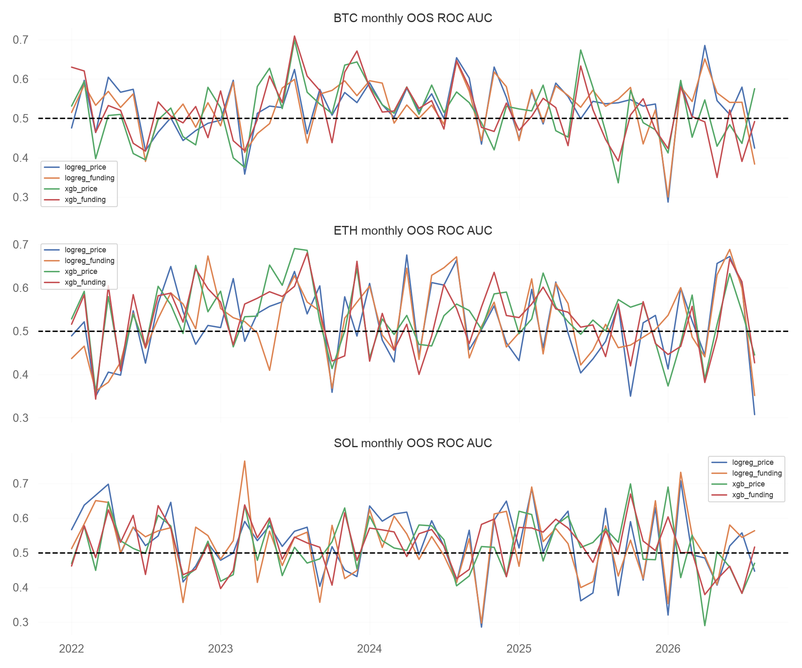

# Do Funding-Rate Anomalies Predict Crypto Perpetual Futures Returns?

An out-of-sample machine learning study on BTC, ETH and SOL perpetual futures, built around strict walk-forward validation and full reproducibility.

## Question

Funding rates on perpetual futures reflect how crowded long or short positioning is. This project asks whether unusual funding rates contain information about the direction of the next 24 hours of returns, beyond what price-based features already capture.

## Short Answer

No robust evidence was found. Across 56 monthly out-of-sample test folds per asset (January 2022 to August 2026):

- Ranking ability was close to random for every model. Out-of-sample ROC AUC ranged from 0.50 to 0.52.
- Adding funding-rate features to price features never improved log loss. For logistic regression on BTC and SOL it made predictions measurably worse.
- After fees, slippage and funding payments, the main model (XGBoost with price and funding features) lost money on all three assets.

These are negative results, and they are reported in full. No parameters were changed after looking at out-of-sample performance.

## Key Results

**Classification performance (out-of-sample)**

| Asset | Dummy AUC | Logistic, price only | XGBoost, price + funding |
|---|---|---|---|
| BTC | 0.506 | 0.513 | 0.508 |
| ETH | 0.496 | 0.500 | 0.514 |
| SOL | 0.500 | 0.520 | 0.515 |

**Incremental value of funding features**

Mean monthly change in log loss when funding features are added to the same model. Positive values mean adding funding made predictions worse. Intervals come from a monthly block bootstrap to allow for overlapping 24-hour labels.

| Asset | Logistic regression | XGBoost |
|---|---|---|
| BTC | +0.0056 [0.0019, 0.0104] | +0.0002 [−0.0042, 0.0045] |
| ETH | +0.0066 [−0.0000, 0.0157] | +0.0015 [−0.0022, 0.0052] |
| SOL | +0.0371 [0.0011, 0.1057] | +0.0003 [−0.0033, 0.0042] |

**Trading backtest, main model (XGBoost, price + funding)**

| Asset | Trades | Return before costs | Net return | Net max drawdown | Net Sharpe |
|---|---|---|---|---|---|
| BTC | 578 | 3.64% | −6.43% | −8.47% | −0.42 |
| ETH | 652 | 0.63% | −10.06% | −13.75% | −0.46 |
| SOL | 583 | 0.64% | −5.61% | −12.93% | −0.15 |

For reference, holding BTC spot with a 10% initial allocation over the same period returned 6.65%. Of the 12 model and asset combinations tested, only one (SOL, logistic regression with price features only) had a positive net return. I treat this as a single favourable scenario and do not claim it as evidence of a signal.





The full report, with all tables and figures, is in [`reports/ml_research/RESEARCH_REPORT.md`](reports/ml_research/RESEARCH_REPORT.md) and [`research_report.html`](reports/ml_research/research_report.html).

## Research Design

**Data.** All market data comes from Binance's official historical archive (data.binance.vision). Every file was checked against the official SHA256 checksum. The sample covers 408 monthly perpetual futures files (January 2021 to August 2026) and BTC spot data for the benchmark. SOL's monthly files were missing 15 eight-hour candles. These were filled with real records from Binance's official daily files and cross-checked against overlapping dates. No values were interpolated or zero-filled.

**Features and label.** The model uses 13 features built only from information available at prediction time: closed price bars, and funding rates treated as available 60 seconds after each settlement. The label is whether the return from the next bar's open to the open 24 hours later exceeds round-trip execution costs (about 0.16%).

**Walk-forward validation.**

- Each model is trained on 12 calendar months and tested on the following month, then the window moves forward by one month.
- Training samples whose labels overlap the test period are purged, with an additional 8-hour embargo.
- Feature scaling is fitted on each training fold only.
- No hyperparameter tuning or early stopping uses the outer test folds. Main model parameters were fixed before any out-of-sample results were viewed.

**Models.** A dummy baseline (training-set class frequency), logistic regression and XGBoost, each trained with and without funding features. This separates the contribution of funding rates from that of price features and model choice.

**Trading rule.** Go long when the predicted probability is at least 0.55, otherwise stay flat. Each trade uses 10% of current equity and is held for 24 hours, with no overlapping positions. Costs are 0.05% fees and 0.03% slippage per side, plus funding payments at actual settlement times.

**Robustness checks.** Results are reported separately for three assets, for alternative feature window lengths (24h/2d/5d and 48h/5d/14d), for slippage from 0% to 0.1%, and by market regime. Performance metrics from QuantStats were checked against hand-written formulas.

## Limitations

- The 60-second funding availability delay is an assumption. It is not the observed historical publication time.
- Funding costs use the last closed price as a proxy for the mark price. Margin liquidation, order latency and market impact are not modelled, so net returns are research approximations.
- Using currently listed major coins introduces survivorship bias.
- The alternative window lengths and the SOL extension were added after the main results had been seen. They are exploratory and are not independent confirmation.
- Because all out-of-sample data has now been viewed, any new hypothesis would need fresh held-out data for a proper test.

## My Role

<!-- Edit this section so it describes exactly what you did. -->

I defined the research question, designed the validation scheme, cost model and robustness checks, and wrote the analysis and conclusions. Much of the code was written with an AI coding assistant (OpenAI Codex). I reviewed and tested the code and checked key results independently, including verifying QuantStats metrics against my own formulas.

## Repository Structure

```
configs/            Model and pipeline configuration
data/raw_archive/   Original Binance ZIP files
data/cache/         Parquet files and source manifests
data/processed/     Features and labels
notebooks/          Executed research notebook
reports/            Research report, fold-level results, backtests
main.py             Pipeline entry point
run_research.sh     Full offline reproduction
```

Key outputs: `fold_metrics.csv` (every fold's metrics), `oos_predictions.parquet` (all out-of-sample predictions), `backtest_summary.json` (returns, drawdowns, cost sensitivity) and `run_metadata.json` (model settings, input hashes, dependency versions).

## Reproducing the Results

Tested with Python 3.14 on macOS ARM64.

```bash
python3 -m venv .venv
.venv/bin/python -m pip install -e '.[dev]'
./run_research.sh
```

`run_research.sh` runs the tests, data import, feature construction, training, backtests and report generation using only local files, with a fixed cutoff of 2026-09-01 UTC. If the raw data is not present, download it first:

```bash
.venv/bin/python main.py --stage data --end 2026-09-01T00:00:00Z
.venv/bin/python -m data.audit_sol_gaps
.venv/bin/python -m data.spot_benchmark
```

Individual stages can be run with `main.py --stage features`, `--stage train` or `--stage report`. On macOS, XGBoost requires `libomp` (see the [XGBoost installation guide](https://xgboost.readthedocs.io/en/stable/install.html)). Pinned dependencies are in `requirements-lock.txt`.

This project is a research exercise. It is not a trading recommendation and the strategy is not suitable for live trading.