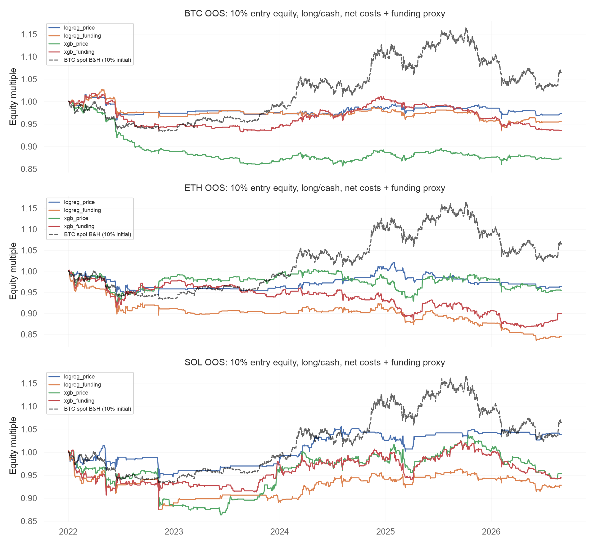
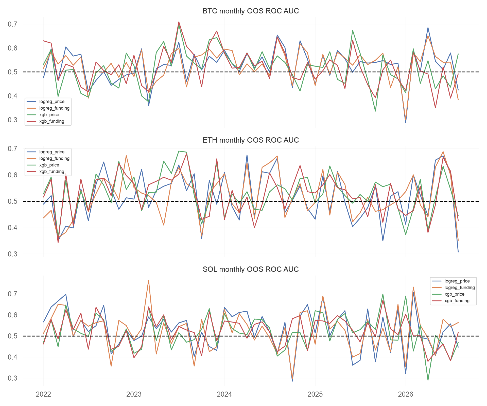

# Crypto ML Quant：滚动样本外研究报告

## 研究结论

本次固定参数研究未发现资金费率特征带来稳定的方向预测增益。不能根据某个正收益场景宣称信号有效。报告保留表现不佳的结果，不使用样本外收益反向调参。

## 验证设计

BTC、ETH、SOL分别训练，2022-01至2026-08，共56个月度测试折／资产。训练12个日历月，每次前推1个月；按label_end_time剔除与测试边界重叠的标签，并额外隔离8小时。每折重新拟合训练集标准化器；XGBoost不用外层测试集early stopping。逻辑回归C=1；XGBoost150树、深度3、学习率0.03、min_child_weight=10、lambda=5、subsample/colsample=0.8，随机种子42。主模型参数在最初查看样本外结果前固定；本次新增窗口长度与SOL分析属于收尾扩展探索，未用来选择最佳模型。

13项特征及24小时标签见../DATASET_METHOD.md。资金费率60秒可用延迟是研究假设，不是观测到的真实公布时间；下一根开盘执行是理想化零计算延迟。单次2025-09固定切分仅检验流程，不是与滚动结果独立的额外证据。

## 分类表现

|资产|模型|样本数|ROC AUC|Log loss|Brier|
|---|---|---:|---:|---:|---:|
|BTC|dummy|5108|0.5056|0.6917|0.2493|
|BTC|logreg_price|5108|0.5134|0.6945|0.2506|
|BTC|logreg_funding|5108|0.5124|0.7001|0.2524|
|BTC|xgb_price|5108|0.5062|0.7090|0.2574|
|BTC|xgb_funding|5108|0.5079|0.7092|0.2574|
|ETH|dummy|5108|0.4963|0.6933|0.2501|
|ETH|logreg_price|5108|0.4995|0.6989|0.2527|
|ETH|logreg_funding|5108|0.5060|0.7053|0.2540|
|ETH|xgb_price|5108|0.5175|0.7067|0.2563|
|ETH|xgb_funding|5108|0.5141|0.7082|0.2570|
|SOL|dummy|5106|0.4995|0.6931|0.2500|
|SOL|logreg_price|5106|0.5197|0.6953|0.2508|
|SOL|logreg_funding|5106|0.5242|0.7313|0.2521|
|SOL|xgb_price|5106|0.5147|0.7071|0.2565|
|SOL|xgb_funding|5106|0.5154|0.7076|0.2567|

模型名称funding表示价格加资金费率，并非仅资金费率。Dummy使用各折训练集阳性比例。AUC约0.5代表排序能力接近随机；Log loss越低越好。每折训练与测试损失、AUC、AP、类别比例、样本数与purge数量完整保留在fold_metrics.csv。

## 资金费率增量证据

|资产|比较|平均月度Log loss差值|月块bootstrap 95%区间|
|---|---|---:|---|
|BTC|logreg_funding minus logreg_price|0.00564|[0.00188, 0.01044]|
|BTC|xgb_funding minus xgb_price|0.00017|[-0.00423, 0.00451]|
|ETH|logreg_funding minus logreg_price|0.00656|[-0.00002, 0.01571]|
|ETH|xgb_funding minus xgb_price|0.00148|[-0.00217, 0.00522]|
|SOL|logreg_funding minus logreg_price|0.03712|[0.00105, 0.10574]|
|SOL|xgb_funding minus xgb_price|0.00033|[-0.00334, 0.00416]|

正差值表示加入资金费率后更差。月块bootstrap考虑24小时标签重叠导致的样本依赖，但相邻月份仍可能相关，区间并非严格显著性结论。

## 交易规则与回测

概率>=0.55时做多，其他时候空仓；每次用当时权益10%的预算，手续费包含在预算内。固定单位持有24小时，只允许一笔活动交易，持仓期间其他信号忽略。退出与下一次入场可在同一开盘边界发生。BTC/ETH/SOL各独立10,000 USDT账户，不是合成投资组合。手续费每侧0.05%，滑点每侧0.03%；资金费率按实际结算时间支付，名义价值用最近已收盘价格代理真实标记价格。无成本版本也不含资金费用，execution版本仅手续费滑点，net版本再计资金费用。

|资产|模型|交易数|无成本收益|净收益（近似）|净最大回撤|净Sharpe|胜率|
|---|---|---:|---:|---:|---:|---:|---:|
|BTC|logreg_price|242|1.58%|-2.66%|-6.02%|-0.197|52.89%|
|BTC|logreg_funding|349|1.62%|-4.39%|-9.05%|-0.309|51.86%|
|BTC|xgb_price|524|-4.05%|-12.59%|-14.54%|-0.893|48.28%|
|BTC|xgb_funding|578|3.64%|-6.43%|-8.47%|-0.422|49.48%|
|ETH|logreg_price|230|0.31%|-3.65%|-6.16%|-0.221|51.30%|
|ETH|logreg_funding|360|-10.28%|-15.58%|-16.67%|-0.902|46.67%|
|ETH|xgb_price|612|6.04%|-4.64%|-8.41%|-0.203|50.65%|
|ETH|xgb_funding|652|0.63%|-10.06%|-13.75%|-0.461|49.69%|
|SOL|logreg_price|226|5.12%|3.87%|-10.25%|0.174|54.42%|
|SOL|logreg_funding|318|-2.53%|-7.20%|-12.91%|-0.307|50.63%|
|SOL|xgb_price|547|2.01%|-4.64%|-14.56%|-0.132|48.81%|
|SOL|xgb_funding|583|0.64%|-5.61%|-12.93%|-0.151|47.34%|

同一持有区间真实BTC现货Buy & Hold（100%投入、无成本）收益66.50%；10%初始投入、固定单位参考收益6.65%。现货基准无持仓资金费；100%基准与10%策略风险预算不同，不能直接用绝对收益判断模型优劣。现货源ZIP已按官方校验，2025起微秒时间戳已显式转换为毫秒。

## 稳健性与限制

- BTC/ETH/SOL跨资产、价格对照、逻辑回归/XGBoost对照，以及单个资金z-score特征子集均完整保存。另实际重算短窗口组合24h/2d/5d及长窗口组合48h/5d/14d，对逻辑回归和XGBoost均重训全部56折，使用相同样本池。窗口实验属于探索扩展，所有结果保留，不据此挑选策略，也不冒充独立确认数据。
- 逐年收益、滑点0–0.1%敏感性、Sortino、回撤持续时间、盈亏比和profit factor见backtest_summary.json。盈亏比为平均盈利／平均亏损绝对值；profit factor为总盈利／总亏损绝对值。
- 市场阶段使用BTC此前180天价格收益，>20%为bull、<-20%为bear，其余sideways；阶段在当日开始前已可用。regime_metrics.csv报告条件日均收益及Sharpe，不把非连续阶段拼接计算回撤。阶段定义是研究约定。
- 每折结果见fold_metrics.csv，不能只依据聚合指标判断稳定性。训练损失低于测试损失可能反映过拟合与市场变化；当前信号弱、历史状态变化和样本有限均可能解释差结果。
- SOL月度文件缺失15根8h K线，已由官方每日8h文件的真实记录补齐；相邻日期每日/月度重叠OHLCV一致，原始缺失时间与校验来源保存在gap_audit.json。结算间隔变化仍按真实时间处理，异常边界重启资金统计。选择现存主流资产仍存在生存者偏差。
- 资金成本缺标记价格、未实现真实保证金清算／盘口冲击／报单延迟；10%仓位用于控制暴露，结果仍为研究性近似，不是可实盘执行证明。
- 因研究者已查看全部样本外结果，后续任何改动必须记录为探索；严格确认新假设需要新的封存数据。
- QuantStats的日Sharpe/Sortino/日最大回撤已与手写公式逐项核对；日最大回撤与8h事件权益回撤可能不同，不应混为同一指标。

## 结果文件

oos_predictions.parquet保留每折概率与时间；每个策略的_equity.csv与_trades.csv可复核。6份QuantStats HTML及两张图、结构化结果一并提供。





## 重现

```sh
./run_research.sh
```
